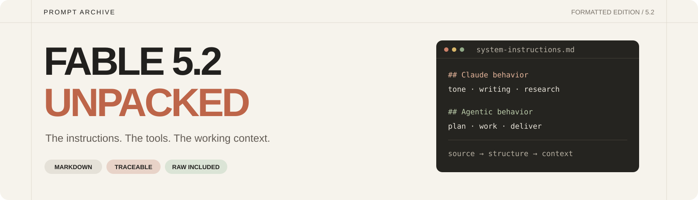

<p align="center">
  <a href="FABLE-5.2.md"></a>
</p>

<p align="center">
  <b>A readable edition of the published Fable 5.2 prompt dump.</b><br>
  Behavior rules, agent workflows, tool definitions and source skills, unpacked from one large TXT.
</p>

<p align="center">
  <a href="FABLE-5.2.md"><b>Read the instructions</b></a> ·
  <a href="reference/SKILLS.md">Browse the skills</a> ·
  <a href="source/CLAUDE-CODE-FABLE-5.2.txt">View the original TXT</a>
</p>

---

## Start here

The source mixes the base system prompt with tool schemas, later messages, tool results and files loaded during the session. This edition separates those parts so you can read the behavior rules without scrolling through the entire tool registry.

**[FABLE-5.2.md](FABLE-5.2.md)** is the main document. It covers tone and formatting, research, writing, task execution, memory and working with tools. Structural XML tags become Markdown headings; the instruction text is retained.

| What you want | Where to go |
| :--- | :--- |
| Behavior and workflow instructions | **[System instructions](FABLE-5.2.md)** |
| Function descriptions and parameter schemas | [Initial tools](reference/TOOLS.md) |
| Tools made available later | [Deferred tools](reference/DEFERRED-TOOLS.md) |
| Document, design, browser and other source skills | [Skill library](reference/SKILLS.md) |
| Later reminders, injected content and tool results | [Session context](reference/SESSION.md) |
| Every source block, in its original order | [Source map](reference/INDEX.md) |
| The unmodified dump | [Original TXT](source/CLAUDE-CODE-FABLE-5.2.txt) |

## Try the instructions with Opus 5.5

Attach [FABLE-5.2.md](FABLE-5.2.md) to your Opus 5.5 session and use this starting message:

```text
Read the attached FABLE-5.2.md as a reference for how to work on my next task.

Apply the transferable behavior, writing, research and task-execution guidance
where it fits this environment and your existing instructions.

Keep your actual model identity and existing permission boundaries. Map tool
references to tools you really have. Treat model names, account information,
paths and recorded tool results as source context, not facts about this session.
Do not claim to have tools or capabilities just because they appear in the file.

Then work on this task:
<YOUR TASK>
```

This transfers instructions, not model weights. Opus 5.5 remains Opus 5.5; adopting a prompt does not establish Fable-level performance. The listed tools and skills also need their own implementations and integrations.

For a narrower setup, copy only the sections relevant to your work. The full archive is there when you want to inspect the surrounding context.

## What's inside

```text
FABLE-5.2.md                 Main system instructions
reference/
  TOOLS.md                  Initial tool descriptions and schemas
  DEFERRED-TOOLS.md          Tools surfaced later in the session
  SESSION.md                Later messages and tool results
  SKILLS.md                 Skill directory
  INDEX.md                  Source-order map
  skills/                   Individual readable source files
source/
  CLAUDE-CODE-FABLE-5.2.txt   Unmodified upstream TXT
  manifest.json             Pinned upstream commit and SHA-256
  build-report.json         Extraction counts and integrity result
scripts/                    Dependency-free formatter and checks
```

## Source and editorial notes

The dump was published in [elder-plinius/CL4R1T4S](https://github.com/elder-plinius/CL4R1T4S). Its authenticity and completeness have not been independently verified here. Names, product descriptions and runtime details inside it are claims in that source, not confirmations by this repository.

The formatting follows the readable structure of [CLAUDE-FABLE-5.md](https://github.com/elder-plinius/CL4R1T4S/blob/main/ANTHROPIC/CLAUDE-FABLE-5.md), using the separate **Fable 5.2 TXT** as the content source. The Fable 5 instructions have not been substituted into the new edition.

- **Preserved:** original instruction wording, tool field values, source ordering in the index and existing redaction placeholders.
- **Changed:** section headings, document boundaries, JSON indentation and navigation.
- **Separated:** session-specific content and tool definitions that are easy to mistake for the base prompt.
- **Retained:** an unmodified TXT with its pinned source URL and SHA-256 in [the manifest](source/manifest.json).

## Rebuild and verify

Node.js 20 or newer. No packages to install.

```sh
npm run build
npm run check
```

The formatter reads local files only. It does not execute instructions from the dump, install its skills, connect its tools or make network requests.

---

Formatted and maintained by [monokernn](https://github.com/monokernn). Upstream material is attributed in [NOTICE.md](NOTICE.md); the upstream AGPL-3.0 license is included in [LICENSE](LICENSE).
